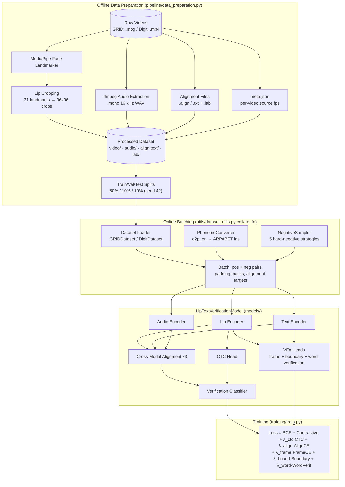
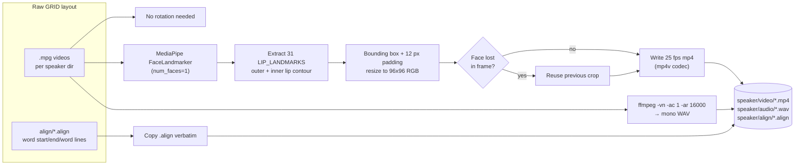
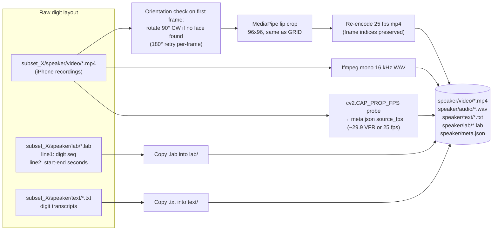
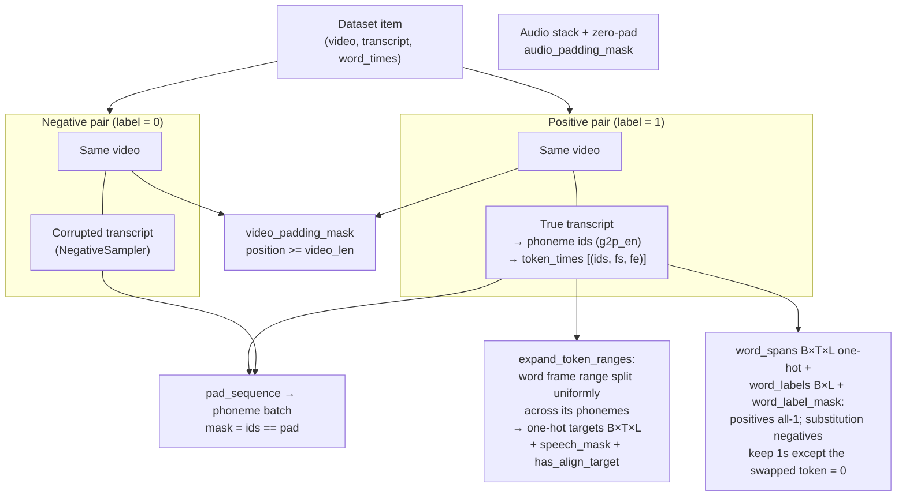
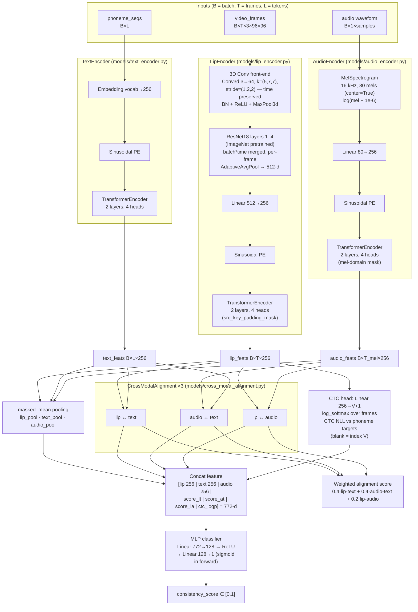
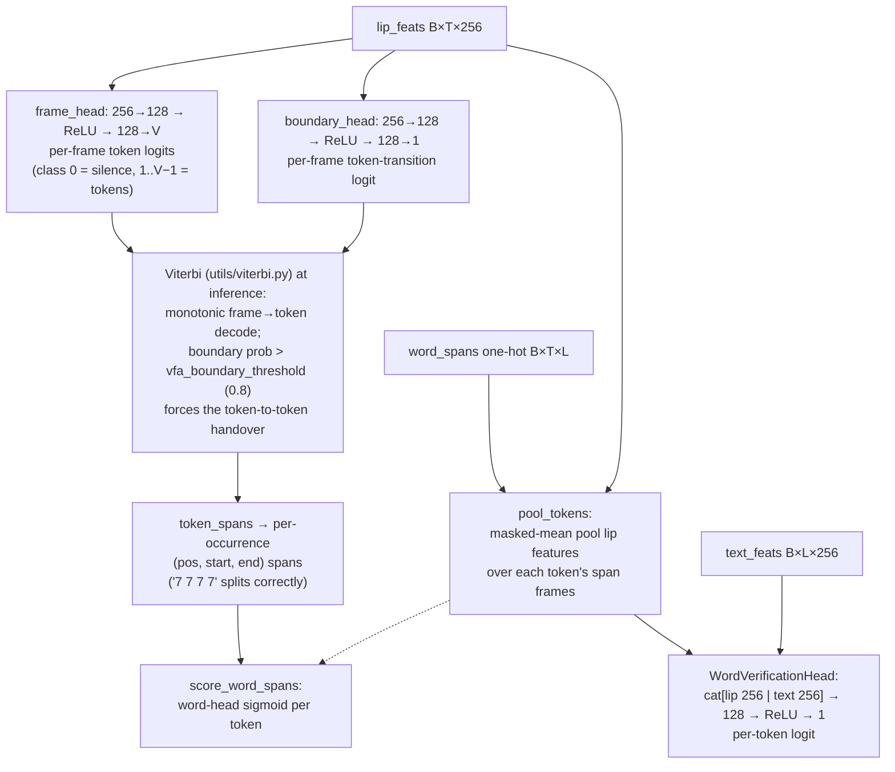
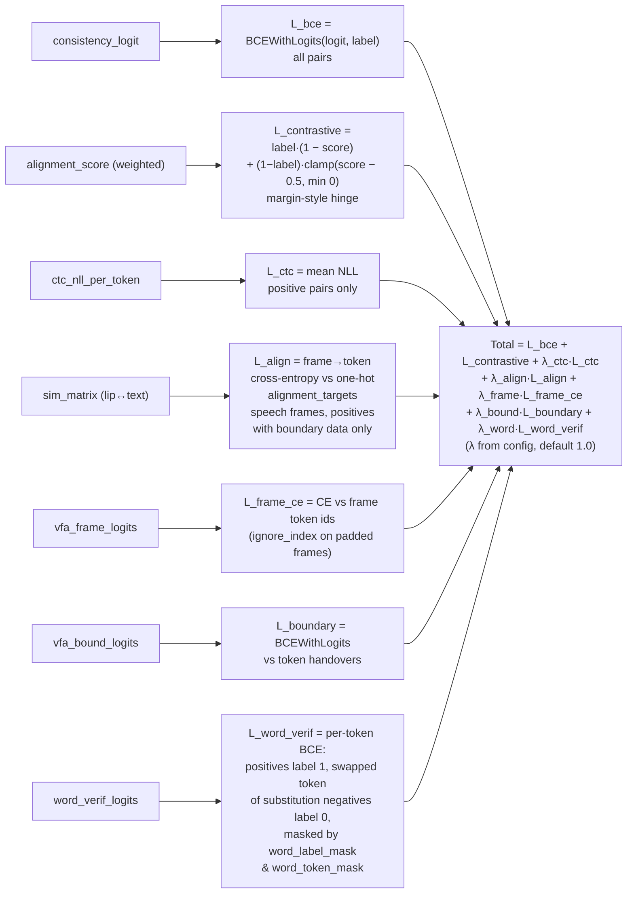

# Lip-to-Text Verification — Model Architecture

This repository implements a **cross-modal lip-to-text verification system**: given a silent lip-video sequence and a candidate transcript, it outputs a consistency score in `[0, 1]` measuring how well the lip movements match the text. It does **not** perform lip reading (visual speech recognition) — it only verifies synchronization/alignment quality between modalities.

The system supports two datasets (**GRID** corpus and a custom **Digit** dataset), optionally fuses an **audio** modality, and is trained with four complementary losses (BCE verification, contrastive alignment margin, CTC boundary supervision, and frame-level alignment supervision).

---

## 1. End-to-End Pipeline Overview

---

## 2. Offline Data Preparation (`pipeline/data_preparation.py`)

A single script normalizes either raw dataset into a common layout. It reads `config.json` to decide which dataset to process (`"grid"` or `"digit"`).

### 2.1 GRID Corpus Preparation

**What happens step by step:**

1. **Speaker scan** — lists speaker directories under `grid_raw_data_dir`; known fully-processed speakers are skipped (resumable pipeline).
2. **Lip extraction** (`dataset/preprocessing.py`) — each `.mpg` frame is converted BGR→RGB and passed through **MediaPipe Face Landmarker**. The 31 landmark indices in `LIP_LANDMARKS` (outer lip ring, inner lip ring, corners) form a bounding box, expanded by 12 px padding, clamped to image bounds, and resized to **96×96**.
3. **Dropout handling** — if detection fails on a frame, the *previous successful crop* is repeated so temporal length is preserved.
4. **Video re-encode** — cropped frames are written as a 25 fps mp4 via `cv2.VideoWriter`.
5. **Audio extraction** (`dataset/audio_extraction.py`) — `ffmpeg -vn -ac 1 -ar 16000` produces mono 16 kHz WAVs (only when `use_audio` is enabled).
6. **Transcripts** — `.align` files are copied unchanged; they contain `start end word` triplets including `sil`/`sp` filler entries.

### 2.2 Digit Dataset Preparation

**Digit-specific details:**

- **Directory structure** — two-level nesting (`subset_X/speaker`) instead of GRID's flat speaker dirs.
- **Orientation correction** — phone videos may be stored rotated; the first frame is checked at low resolution, and if no face is detectable the video is rotated 90° clockwise (with a 180° per-frame retry fallback).
- **Source-fps metadata** — before re-encoding, the raw video's fps is probed and stored in `meta.json`. This matters because the 25 fps re-encode preserves frame indices but relabels the timebase; `.lab` timestamps (seconds) must be converted at the *source* rate (~29.87 fps VFR or 25 fps depending on device).
- **Boundary supervision** — `.lab` files carry per-digit `start-end` second ranges (line 1 = digit sequence, line 2 = matching ranges), which later become frame-alignment training targets.

### 2.3 Split Creation

After processing all speakers, all processed videos are globbed, shuffled with `random.seed(42)`, and split **80% train / 10% val / 10% test**, written as `train_split.json`, `val_split.json`, `test_split.json` manifests containing absolute video paths.

---

## 3. Online Dataset Loading & Batch Construction

### 3.1 Dataset Loaders

| | `GRIDDataset` | `DigitDataset` |
|---|---|---|
| Frame budget | `max_frames = 75` (3 s @ 25 fps) | `max_frames = 125` (p95 clip length) |
| Transcript tokens | ARPABET phonemes (vocab 41 = 39 phonemes + `<pad>` + `<unk>`) | Digits `0–9`, `!`, `<pad>`, `<unk>` (vocab 13) |
| Boundary source | `.align` word times | `.lab` digit times |
| Timebase fix | Proportional calibration: `frame = value · video_len / max_end` (raw values are ~25 kHz sample units) | `seconds_to_frame(s, source_fps)` using `meta.json`, fallback inference `frames/duration`, then config default |

Both loaders:

1. Read their split manifest and reconstruct `{video, audio, align}` paths.
2. Load the pre-cropped mp4, convert to RGB tensors normalized to `[-1, 1]` (`ToTensor` + `Normalize(0.5, 0.5)`).
3. **Temporal padding**: truncate to `max_frames`, or pad by repeating the last frame; return the **true length** so downstream modules can build padding masks.
4. **Audio sync** (`_load_audio`): trim/pad the waveform to exactly the span covered by kept frames (`sr · video_len / 25` samples) so audio and video never desync.
5. Emit `{video, transcript, video_len, word_times?, audio?, audio_len?}`.

### 3.2 Collate Function — Pair Construction & Alignment Targets

`collate_fn_factory` (utils/dataset_utils.py) turns each dataset item into **two training pairs**:

**Text → phonemes** (`utils/phoneme_converter.py`): lowercases/strips punctuation, runs `g2p_en` (CMU dict + neural fallback), removes stress digits, maps to a fixed 39-phoneme ARPABET vocabulary. Crucially, `text_to_phoneme_indices_per_word` keeps **per-word phoneme groups** so word-level boundary times can be distributed across each word's phonemes — the same indices feed both the text encoder and the alignment target axis.

**Negative sampling** (`utils/negative_sampler.py`) picks one of five strategies at random:

| Strategy | Corruption |
|---|---|
| `hard` | Most lexically similar transcript (token-overlap Jaccard) from a random 64-candidate subset |
| `wrong` / `random` | Random other transcript from the pool |
| `shuffled` | Word order shuffled |
| `phoneme_similar` | Swap one word with a phonetically confusable word from the same GRID grammar class (color↔color, letter↔letter, digit-word↔digit-word); for digits, swap one digit |

A global guard guarantees the negative ≠ positive (e.g., shuffling `"7 7 7 7"` would otherwise produce a mislabeled pair). Negatives get empty `token_times` — a mismatched transcript has no valid alignment supervision.

**Per-token verification supervision** — alongside `alignment_targets`, the collate emits three tensors for the VFA word-verification head (§4.7): `word_spans` (`B×T×L` one-hot, mirroring `alignment_targets` but also built for *single-substitution* negatives, whose frames still articulate every token except the swap), `word_labels` (`B×L`, 1 on true tokens, 0 on the swapped token) and `word_label_mask` (which positions carry supervision). For digits the swap replaces the frame range's token id at the substituted position; for GRID the swapped word keeps its frame range and only its phoneme ids/labels are replaced (skipped when the word's phoneme count differs). Non-substitution negatives carry no per-token supervision.

---

## 4. Model Architecture (`models/verification_model.py`)

`LipTextVerificationModel` encodes three modalities into a shared 256-d space, scores pairwise cross-modal alignment, adds a CTC-derived likelihood feature, and classifies consistency.

### 4.1 Lip Encoder — spatio-temporal visual stream

1. **3D convolution front-end** — a `Conv3d` with kernel `(5, 7, 7)` and **stride 1 along time** captures short-term lip dynamics over a 5-frame window while keeping the sequence length `T` intact (spatially it downsamples like a standard stem).
2. **Per-frame spatial backbone** — batch and time are merged `(B·T)` and pushed through pretrained **ResNet18** layer1–4 + adaptive average pooling → a 512-d descriptor per frame.
3. **Projection + positional encoding** — `Linear 512→256`, then fixed sinusoidal positions inject frame order.
4. **Temporal transformer** — 2-layer/4-head `TransformerEncoder` models long-range mouth dynamics across the whole clip; padded (repeated-last-frame) positions are excluded via `src_key_padding_mask`.

Output: contextual lip features `B × T × 256`.

### 4.2 Text Encoder — phoneme stream

Token embeddings (vocab → 256) + sinusoidal positional encoding → the same 2-layer transformer architecture. Output: `B × L × 256`. Using phonemes rather than words makes the representation pronunciation-oriented, which matches what lips actually articulate.

### 4.3 Audio Encoder — acoustic stream

Raw waveforms are transformed inside the model by a differentiable **80-mel MelSpectrogram** (16 kHz, `center=True` so mel length is deterministic: `T_mel = samples // hop + 1`), log-compressed, projected 80→256, position-encoded, and run through the same transformer block. The sample-domain padding mask is converted to the **mel-frame domain** (`_mel_domain_mask`: a mel frame is valid iff its analysis window starts within real audio).

### 4.4 Cross-Modal Alignment module (used three times)

Each `CrossModalAlignment` instance scores how well two modalities correspond:

1. **Cosine similarity matrix** — L2-normalized features multiplied to a `B × T × L` grid; padded rows/columns filled with `-1e9`.
2. **Multi-head cross attention** — query = one modality, key/value = the other, producing aligned features and attention weights (returned for inspection).
3. **Word-level score** — for each token, take the **max similarity over all frames** ("does this phoneme appear clearly at some point?"), then average over valid tokens.
4. **Score mapping** — the mean max-cosine in `[-1, 1]` is mapped to `[0, 1]` via `(x + 1) / 2`.

Three instances score **lip↔text**, **audio↔text**, and **lip↔audio**; their weighted combination (0.4 / 0.4 / 0.2) forms the overall alignment score used by the contrastive loss.

### 4.5 CTC Head — boundary-aware likelihood feature

A linear head maps every lip frame to `vocab_size + 1` logits (extra class = CTC blank). `F.ctc_loss` (reduction `'none'`, `zero_infinity=True`) computes, per sample, the negative log-likelihood that the lip sequence *transcribes* to the paired phoneme sequence, normalized per target token to stay bounded (~[-10, 0]) regardless of length. Two roles:

- **Training loss** — applied to positive pairs only (negatives have mismatched transcripts; forcing alignment there would contradict the verification objective).
- **Classifier feature** — `-ctc_nll` (a per-token log-likelihood) is appended to the classifier input, making the final decision explicitly alignment-aware: a video can't score high unless its mouth movements could plausibly produce the claimed text.

Samples where `input_length < target_length` (or empty targets) are masked out via `ctc_valid`.

### 4.6 Verification Classifier

Concatenates `[pooled lip (256) | pooled text (256) | pooled audio (256) | 3 alignment scores | 1 CTC log-prob]` = **772 dims** → `Linear 772→128` → ReLU → `Linear 128→1` → **Sigmoid** → consistency score. All pooling uses `masked_mean` so padded positions never leak into the decision.

When audio is disabled (`use_audio=false`), the audio pool and the two audio-related scores are zeros and the model degrades gracefully to lip-vs-text only.

### 4.7 VFA Heads — forced alignment + per-token verification

When `use_vfa=true` (the default; `false` omits the heads entirely so legacy checkpoints strict-load), three extra heads read the shared encoder features (models/vfa_heads.py):

- **Frame head** — per-frame logits over `[silence + vocab]` (class 0 is silence; the `<pad>` id never appears in transcripts). Supervised with cross-entropy (`ignore_index` on padded frames) against frame token ids derived from the `.align`/`.lab` boundary times.
- **Boundary head** — one transition logit per frame, trained with `BCEWithLogits` against token-to-token handovers in the ground-truth alignment.
- **Word verification head** — for each token position, span-pool the lip features and concatenate the text-encoder embedding → a per-token logit: the per-token analogue of the global classifier, so *"which digit was wrong"* becomes answerable, not just *"the clip is wrong"*.

**Batch plumbing** — when the collate provides `word_spans`, `forward(..., word_spans=...)` additionally emits `vfa_frame_logits`, `vfa_bound_logits`, `word_verif_logits` and a `word_token_mask`; `lip_feats`/`text_feats` are always returned so inference can run the Viterbi/word-head path without recomputing the encoders. Checkpoints stamp `vfa_heads=true`.

**Viterbi at inference** (utils/viterbi.py, ported from Visual-Forced-Alignment): a monotonic frame→token decode over the frame posteriors with two refinements — forced boundary transitions are pinned to token-to-token handovers (matching the boundary head's training targets), and boundary probabilities above `vfa_boundary_threshold` force the transition; a boundary peak the path fails to honour triggers a retry without boundary hints. `token_spans(frame_to_label, labels)` takes the full label sequence `[0] + token_ids + [0]` and assigns **per-occurrence** positions, so repeated tokens (`"7 7 7 7"`) split correctly; videos shorter than the token count fall back to `uniform_token_spans(T, n)`. The public `score_word_spans(lip_feats, text_feats, word_spans)` then runs the word head on the decoded spans.

---

## 5. Training Objective (`training/train.py`)

Four base losses are summed per batch (each batch contains interleaved positive/negative pairs), plus three VFA terms when the heads and their supervision tensors are present:

- **BCE** trains the sigmoid classifier directly against the pair label.
- **Contrastive margin** shapes the alignment score itself: positives pulled toward 1; negatives pushed below an implicit 0.5 margin (no gradient once below it).
- **CTC** teaches the lip encoder frame-level articulation structure (which frames produce which phonemes).
- **Frame-level alignment CE** (`alignment_kl_loss`) supervises the cosine similarity matrix against the one-hot `alignment_targets` built from `.align`/`.lab` boundaries — each speech frame must attend to exactly its current phoneme. Per-sample means are averaged only over samples with targets, so partial boundary coverage doesn't bias the loss.
- **VFA frame CE** (`vfa_frame_ce_loss`, weight `lambda_frame_ce`) trains the frame head's per-frame token logits (`ignore_index` on padded frames).
- **VFA boundary BCE** (`vfa_boundary_loss`, weight `lambda_boundary`) trains the boundary head on token-to-token handovers.
- **VFA word verification BCE** (`word_verification_loss`, weight `lambda_word_verif`) trains the per-token head on positives (all tokens label 1) and single-substitution negatives (swapped token label 0), active only where `word_label_mask & word_token_mask`. All three run only when the checkpoint was built with `vfa_heads=true` and the batch carries the supervision tensors.

**Orchestration** (`main.py`): DDP over all visible GPUs (torchrun or auto-spawn), Adam (lr 1e-4), per-epoch validation computing **ROC AUC, EER, verification accuracy** (`evaluation/`), TensorBoard scalars, and per-epoch checkpoints.

---

## 6. Component Summary Table

| Component | File | Input → Output | Role |
|---|---|---|---|
| Data prep | `pipeline/data_preparation.py` | raw videos → 96×96 lip mp4 + 16 kHz wav + alignments + splits | Offline normalization, MediaPipe lip cropping |
| Lip preprocessing | `dataset/preprocessing.py` | frame → 96×96 lip crop | 31-landmark bounding box, dropout fallback, orientation fix |
| Audio extraction | `dataset/audio_extraction.py` | video → mono 16 kHz wav | ffmpeg strip |
| GRID loader | `dataset/grid_loader.py` | manifest → tensors | `.align` parsing + proportional timebase calibration |
| Digit loader | `dataset/digit_loader.py` | manifest → tensors | `.lab` parsing + per-video source-fps resolution |
| Pair builder | `utils/dataset_utils.py` | items → batch | Positive/negative pairing, masks, alignment targets |
| Phoneme converter | `utils/phoneme_converter.py` | text → ARPABET ids | g2p_en, per-word grouping |
| Negative sampler | `utils/negative_sampler.py` | transcript → corrupted transcript | 5 hard-negative strategies |
| Alignment targets | `utils/alignment.py` | word times → one-hot B×T×L | Uniform word→phoneme frame splitting |
| VFA heads | `models/vfa_heads.py` | lip_feats/text_feats + span one-hot → frame/boundary logits, per-token logit | Forced-alignment targets + per-token verification |
| Viterbi aligner | `utils/viterbi.py` | frame logits + boundary probs → frame→token labels, per-occurrence spans | Monotonic decode, boundary-forced handovers, short-video fallback |
| Lip encoder | `models/lip_encoder.py` | B×T×3×96×96 → B×T×256 | 3D conv + ResNet18 + transformer |
| Text encoder | `models/text_encoder.py` | B×L → B×L×256 | Embedding + transformer |
| Audio encoder | `models/audio_encoder.py` | waveform → B×T_mel×256 | Mel + projection + transformer |
| Alignment module | `models/cross_modal_alignment.py` | two feature sets → score ∈ [0,1] | Cosine sim + cross attention + max-pooling |
| Full model | `models/verification_model.py` | triplet + masks → score, aux outputs | Fusion, CTC feature, sigmoid classifier |
| Trainer | `training/train.py` | batches → updates | 7-term composite loss (4 base + 3 VFA) |
| Orchestrator | `main.py` | config → trained checkpoint | DDP, eval loop, TensorBoard |
